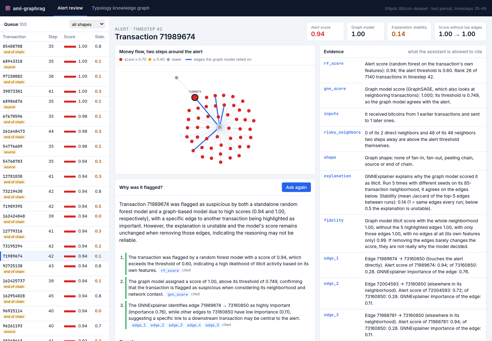
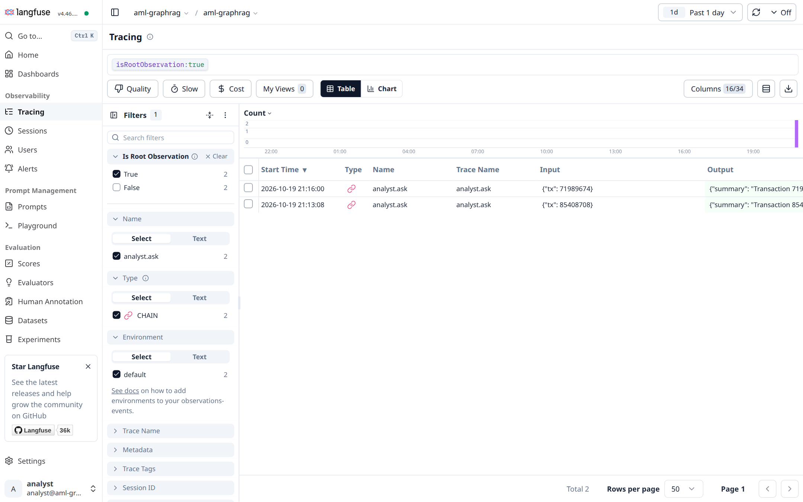

# aml-graphrag

**An assistant for anti-money laundering analysts that has to show its sources.** It reviews alerts on Bitcoin
transactions, explains why each one was flagged, and every claim it makes points at the fact in the transaction graph
or the passage in a knowledge graph that supports it. Then it checks itself: claims without a source, with a source
it was never given, or with numbers that don't match the source are marked in red.

It runs on one gaming PC (RTX 4060, 8 GB) with local models only: no API keys, no data leaves the machine.



## Two papers, one product

**GraphRAG** (Edge et al., Microsoft, 2024, [arXiv:2404.16130](https://arxiv.org/abs/2404.16130)) says that the usual
retrieval-augmented generation (find the passages most similar to the question) fails on *global* questions about a
whole corpus ("what techniques show up across these cases?"), because no single passage holds the answer. Their fix:
have an LLM turn the corpus into a knowledge graph, split it into communities, summarize every community, and answer
by map-reduce over the summaries. I rebuilt that pipeline from scratch and repeated their evaluation at a smaller
scale ([results/graphrag](results/graphrag)).

**Elliptic** (Weber et al., 2019, [arXiv:1908.02591](https://arxiv.org/abs/1908.02591)) is the public Bitcoin
transaction graph with illicit/licit labels. I reproduced their random forest result and compared it with a graph
neural network ([results/gnn](results/gnn)).

**My addition** is what the GraphRAG paper says it didn't measure: whether the answers make things up. The assistant
answers "why was this transaction flagged, and how much should I trust that?" in three ways, and I count how many of
its claims are actually backed by what it was given ([results/analyst](results/analyst)).

## What came out

**GraphRAG reproduces.** On 42 global questions, root-level community summaries (C0) beat plain vector RAG in
comprehensiveness 77%, diversity 89% and empowerment 82%, judged head to head by a different model in both orders.
The paper reports 72–83% and 62–82%. Half of the vector RAG answers (21 of 42) open with "the passages don't contain
enough information". The next level down (C1) costs 7 times more LLM calls and the judge can barely tell it from C0.
[Details](results/graphrag).

**The graph model loses to a random forest, and its explanations are shaky.** I reproduced Weber et al.'s random
forest (F1 0.82 vs. 0.79 published). GraphSAGE gets PR-AUC 0.48–0.53 against the forest's 0.77, so the forest scores
the alerts. Run GNNExplainer five times and 56 of 100 alerts get a different set of edges (stability below 0.5). When
the graph model agrees with the alert, removing the edges it "relied on" changes its score in only 7 of 40 cases. Every
model collapses at timestep 43, when a dark market shut down. [Details](results/gnn).

**Asking for citations stops the invention; the graph makes the answer useful.** With only an alert score and no rule
to cite, the model invented specifics in 30 of 30 free answers, mostly what the anonymized features "measure". With
the same score and the citation rule, 96% of its claims are grounded. But all it does is repeat the score. Given the
graph facts, it cites 5.1 facts per answer. It says the graph model disagrees in 54 of the 60 cases where it does, and
warns about every unstable explanation. Its errors are misreadings, not inventions: 90% of its claims are grounded.
Rewording one kind of fact took one kind of misreading from 43 answers to 0. [Details](results/analyst).

## How it works

```
Wikipedia (106 articles on laundering, AML law, crypto crime, cases)
   -> 434 chunks of 600 tokens
   -> qwen3:4b extracts entities and relationships          8,136 entities, 9,200 relationships
   -> hierarchical Leiden communities                       C0: 51 communities, C1: 503
   -> a report per community, bottom-up                     554 reports
   -> global search: map over reports, reduce the best points

Elliptic (203,769 transactions, 234,355 money flows)
   -> random forest scores every transaction                the alert score
   -> GraphSAGE + GNNExplainer x 5 seeds                    which edges, how stable, how faithful
   -> facts with ids: score and rank, neighbors, shape, explanation, fidelity

Alert + facts + the community reports that match its shape
   -> qwen3:4b answers with claims that cite fact ids and source ids
   -> code checks every citation and every number
```

- **Local models through Ollama.** `qwen3:4b-instruct` does all the generation, with JSON schemas for structured output.
  `qwen3:8b` only judges, so no model grades its own answers. `nomic-embed-text` does the embeddings.
- **The GNN part** uses PyTorch Geometric. Its hyperparameters and label handling come from my master's thesis
  on the stability of GNN explanations for money laundering detection (with Alejandro Gómez Huertas, directed by
  Cristian Rosero Arias, Universidad Tecnológica de Pereira).
- **Clean architecture:** `domain/` is pure Python (claim checking, context packing, stability, graph shapes, win rates),
  `application/` holds the pipelines, `adapters/` talk to Ollama, Wikipedia, Elliptic's files and Langfuse,
  `entrypoints/api.py` is FastAPI. The tests use fake models and never call Ollama.
- **Angular console** (`web/`): the alert queue, a cytoscape.js view of the money flow around the alert with the
  explanation's edges in blue, the evidence table, and the answer. Hover a claim and its sources light up.
  The second tab browses the community reports and asks global questions.
- **Langfuse**, self-hosted with Docker: every LLM call is traced (prompt, reply, tokens, latency) under the request
  that caused it, and every analyst answer gets an automatic `cited_claims` score.

  

## Run it

You need [uv](https://docs.astral.sh/uv/), [Ollama](https://ollama.com), Node 20+ and Docker (only for Langfuse).

```bash
ollama pull qwen3:4b-instruct && ollama pull qwen3:8b && ollama pull nomic-embed-text
./run.sh ollama          # Ollama with 3 parallel slots and a q8 KV cache (in its own terminal)
./run.sh corpus          # download the Wikipedia articles listed in data/corpus/articles.txt
./run.sh index           # extraction + communities + reports (about 2.5 h on an RTX 4060)
./run.sh gnn             # needs the Elliptic CSVs in data/elliptic/raw/ (Kaggle: ellipticco/elliptic-data-set)
./run.sh evaluate        # questions, answers, judging, analyst evaluation
./run.sh langfuse        # optional: tracing UI on http://localhost:3000
./run.sh api             # http://localhost:8000
./run.sh web             # http://localhost:4200
./run.sh test
```

Neither the Wikipedia texts nor Elliptic are in the repo. The manifest pins every article's revision, so the corpus
can be fetched again exactly as it was.

## What didn't work

- **FATF reports as the corpus.** They're the reference on laundering typologies, but the FATF site blocks automated
  downloads and doesn't publish reuse terms, so I used Wikipedia.
- **The paper's extraction prompt as is, on a 4B model.** It pulled out 30 entities per chunk, including things like
  "five-year prison sentence", at 50 seconds a chunk: 10 hours for the corpus. A tighter prompt (named things and
  techniques only, one-sentence descriptions) and three parallel requests with a q8 KV cache brought it to 14 s.
- **Running three parallel requests with a big context.** The KV cache spilled 17% of the model to the CPU and it got
  slower, not faster. Flash attention plus an 8-bit cache fixed it. Mixing two context sizes made Ollama reload the
  model on every switch.
- **The full hierarchy.** Three levels meant 1,344 community reports (2.6 hours). I kept two. C1 was still so expensive
  at query time (89 LLM calls per answer) that I ran it on 12 questions.
- **Training the GNN on the CPU while the LLM was indexing.** Ollama's structured output needs the CPU too; both
  crawled until I limited PyTorch to 6 threads.
- **My first graph shapes.** I looked for fan-in, fan-out and peeling chains, and found them in 2 of 100 alerts. Most
  alerts are the end of a chain or a source, so those became shapes too.
- **My first fidelity number.** It said removing the explanation's edges barely changed the score, which looked like
  "explanations are useless". But GNNExplainer explains the class the model *predicted*, and for 60 of the alerts that
  class is "not illicit". Measured against the predicted class, the story splits in two (see results/gnn).
- **Writing an edge as "alert scores 0.24 → 1.00".** The model read the arrow as the score changing along the edge, in
  the evaluation and again in the demo. Writing the two scores separately fixed it (43 answers to 0).
- **The judge isn't neutral on length.** In the paper vector RAG was the most "direct"; here GraphRAG wins directness
  too, with answers twice as long. Judging in both orders removes position bias, not length bias.

## Credits and licenses

- Corpus: English Wikipedia, [CC BY-SA 4.0](https://creativecommons.org/licenses/by-sa/4.0/); article list and
  revisions in [`data/corpus/manifest.json`](data/corpus/manifest.json).
- Elliptic data set: Weber et al., *Anti-Money Laundering in Bitcoin: Experimenting with Graph Convolutional Networks
  for Financial Forensics*, KDD Workshop on Anomaly Detection in Finance, 2019. Not redistributed here.
- GraphRAG: Edge et al., *From Local to Global: A Graph RAG Approach to Query-Focused Summarization*, 2024.
  This is an independent reimplementation, not Microsoft's `graphrag` package.
- Langfuse's `docker-compose.yml` is from [langfuse/langfuse](https://github.com/langfuse/langfuse) (MIT), images pinned.
- Code: MIT.
